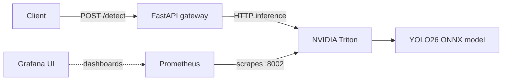

# YOLO26 Inference Deployment Lab

<p align="center">
  <strong>From model optimization to a containerized, GPU-backed object detection API.</strong>
</p>

<p align="center">
  
  
  
  
  
</p>

This project explores the practical path from a computer vision model to an inference service. It compares model runtimes and precisions, serves YOLO26 through NVIDIA Triton, exposes a FastAPI endpoint, and makes Triton metrics available to Prometheus.

## Project at a glance

- **Model:** YOLO26 Nano object detector
- **Model formats explored:** PyTorch, ONNX Runtime, TensorRT, OpenVINO, and TFLite
- **Serving stack:** NVIDIA Triton Inference Server with a FastAPI gateway
- **Deployment:** Docker Compose with NVIDIA GPU access
- **Observability:** Prometheus scrape configuration for Triton metrics; Grafana service included
- **Best measured GPU result:** TensorRT FP16 reached **1.01 ms median inference latency** in the local benchmark run

## Results

The table below summarizes measurements collected with the local Ultralytics benchmark script (`src/bench.py`). The raw log is written to the ignored `results/bench.jsonl` file in the working project. These measurements compare model execution; they are **not** a load test of the Triton HTTP service.

| Model / runtime | Device | Median inference (ms) | Tail inference (ms) | Pipeline throughput (FPS) |
|---|---|---:|---:|---:|
| PyTorch FP32 | GPU | 10.12 | 12.17 | 74.0 |
| ONNX Runtime FP32 | CUDA | 14.51 | 16.93 | 48.8 |
| ONNX Runtime FP32 | CPU | 16.28 | 21.88 | 45.8 |
| TensorRT FP16 | GPU | **1.01** | 2.90 | 229.4 |
| TensorRT INT8 | GPU | 1.06 | **2.65** | **251.1** |
| OpenVINO FP32 | CPU | 15.22 | 31.94 | 52.3 |
| OpenVINO INT8 | CPU | 13.84 | 20.93 | 59.2 |
| TFLite INT8 | CPU | 56.76 | 63.73 | 16.8 |
| TFLite INT8 | CUDA | 34.57 | 44.87 | 25.4 |

In this run, TensorRT FP16 reduced median model inference time from **10.12 ms to 1.01 ms** versus the PyTorch FP32 GPU baseline, about **10x lower latency**. TensorRT INT8 recorded the highest pipeline throughput in this comparison.

> **How to read these numbers:** The benchmark warms up the model for 30 predictions, then measures 300 predictions on a 640-pixel input. The script writes a field named `infer_p90_ms`, but currently calculates the 95th percentile; the "Tail inference" column above reflects that calculation. Hardware details are not stored with the result rows, so treat these as measurements from one local environment. The throughput is computed from Ultralytics prediction timings, not API requests per second. No accuracy or mAP scores are included in the saved benchmark results.

## Architecture



The Triton repository includes two GPU model configurations:

- `yolo_onnx_cuda` uses the ONNX Runtime GPU execution path.
- `yolo_onnx_trt` enables the TensorRT execution accelerator in FP16 mode.
- Both configurations allow batches up to 8 and set a 5 ms dynamic batching queue delay.

The FastAPI gateway accepts an image upload, sends it through the Ultralytics Triton integration, and returns detected labels, confidence scores, bounding boxes, and model timing information.

## Run the deployment

### Prerequisites

- Docker Desktop with Docker Compose v2, or Docker Engine with the Compose plugin
- An NVIDIA GPU and a working NVIDIA Container Toolkit / Docker GPU passthrough setup
- The repository's Triton model files under `model_repository/`

On Windows, Docker Desktop must be configured for WSL2 GPU access. Triton needs time to start and load the model before the first detection request.

### Start the services

```powershell
docker compose up --build
```

Check the gateway health endpoint:

```powershell
curl.exe http://localhost:8080/health
```

Send the included sample image to the detector:

```powershell
curl.exe -X POST http://localhost:8080/detect -F "file=@assets/test.jpg"
```

The gateway's interactive API documentation is available at <http://localhost:8080/docs>.

Stop the stack with:

```powershell
docker compose down
```

### Service endpoints

| Service | Address | Purpose |
|---|---|---|
| FastAPI gateway | `http://localhost:8080` | `/detect`, `/health`, and `/docs` |
| Triton HTTP | `http://localhost:8000` | Model inference and server API |
| Triton gRPC | `localhost:8001` | gRPC inference endpoint |
| Triton metrics | `http://localhost:8002/metrics` | Prometheus scrape target |
| Prometheus | `http://localhost:9090` | Metrics collection UI |
| Grafana | `http://localhost:3000` | Dashboard UI |

Prometheus is configured to scrape Triton's metrics endpoint. Grafana is included in Compose; configure its Prometheus data source and dashboards in Grafana to explore those metrics.

## Benchmark and model tools

The project scripts support local model experiments in addition to the containerized serving path. Set up the Python 3.11 environment and dependencies with [uv](https://docs.astral.sh/uv/). Place the `yolo26n.pt` checkpoint in the project root before running the commands; this root checkpoint is excluded from Git.

```powershell
uv sync

# Compare a model on the GPU or CPU; each run appends one JSON row under results/.
uv run python src/bench.py yolo26n.pt 0 pytorch-fp32-gpu
uv run python src/bench.py yolo26n.pt cpu pytorch-fp32-cpu

# Run COCO128 validation and print mAP50-95.
uv run python src/val.py yolo26n.pt 0

# Export the configured INT8 OpenVINO variant into artifacts/.
uv run python src/export_all.py
```

`src/bench.py` accepts `<model_path> <device> [label]`; use `0` for the first NVIDIA GPU and `cpu` for CPU inference. Runtime-specific formats such as TensorRT engines and OpenVINO IR require their corresponding backend dependencies and hardware support.

## Repository layout

```text
gateway/             FastAPI application and gateway Dockerfile
model_repository/    Triton model configs and ONNX weights
monitoring/          Prometheus scrape configuration
src/                 Export, benchmark, and validation scripts
assets/              Sample detection image
docker-compose.yml   Triton, gateway, Prometheus, and Grafana services
```

Generated exports in `artifacts/`, benchmark output in `results/`, local environments, and the `docs/` directory are excluded by `.gitignore`.

## Skills demonstrated

- **Computer vision inference:** YOLO object detection, image preprocessing, bounding-box results, and COCO validation workflow
- **Model deployment formats:** PyTorch, ONNX, TensorRT FP16/INT8, OpenVINO, and TFLite benchmarking
- **Inference serving:** NVIDIA Triton model repository, GPU execution providers, dynamic batching, and model-serving integration
- **API engineering:** FastAPI upload endpoint, input validation, and structured JSON responses
- **Containers, observability, and CI:** Docker Compose, GPU-enabled containers, Prometheus metrics scraping, Grafana integration, and a GitHub Actions workflow for linting and gateway image builds
- **Performance engineering:** warm-up runs, percentile latency reporting, throughput comparison, and model-format trade-offs

## Current scope

This repository is a practical deployment and benchmarking project. The results above come from a local single-image benchmark; its raw JSONL is ignored by Git. The project does not yet include Triton concurrency/load-test results, saved accuracy comparisons for each precision, or pre-provisioned Grafana dashboards. Those are useful next steps for making performance and accuracy trade-offs reproducible across machines.

## License

Distributed under the [MIT License](LICENSE).
